# Harness Engineering with Claude and Claude Code

A four-system capstone project demonstrating **harness engineering**: the deliberate design of the code and configuration that wraps Claude model calls to make agentic systems safe, cost-bounded, and reliable enough to run unattended in production.

Each system tackles a different layer of the agentic-systems stack — control flow, context management, team configuration, and cross-invocation orchestration — and each was built, tested, and run end-to-end against live Claude output.

---

## Table of Contents

- [Overview](#overview)
- [Results at a Glance](#results-at-a-glance)
- [Architecture](#architecture)
- [The Four Systems](#the-four-systems)
- [Problem → Solution](#problem--solution)
- [Repository Structure](#repository-structure)
- [Getting Started](#getting-started)
- [Running Each System](#running-each-system)
- [Standout Work](#standout-work)
- [Key Findings](#key-findings)
- [Known Limitations](#known-limitations)
- [Deliverables](#deliverables)
- [References](#references)

---

## Overview

A single unstructured call to a large language model is not sufficient for production agentic work. Left ungoverned, an agentic loop can run indefinitely, call tools unsafely, lose track of context as a conversation grows, or silently regress after a crash with no way to recover cleanly.

This project answers that problem four ways:

| # | System | Governs |
|---|--------|---------|
| 1 | **Claims Intake Agent** | A single agent's control flow (loop termination, tool safety, escalation) |
| 2 | **Retail Context Strategy** | What an agent sees as a conversation grows (compression, fact preservation) |
| 3 | **Claude Code Configuration** | How a team scopes AI assistance across a codebase (rules, skills, permissions) |
| 4 | **Multi-Shift Orchestration** | How state persists and recovers across independent runs over time |

Every system pairs **deterministic, code-enforced guarantees** (a byte cap, a read-only tool allowlist, an append-only write) with **prompt-guided judgment** (how to phrase a summary, which hypothesis to investigate) — and puts each kind of guarantee where it belongs.

---

## Results at a Glance

| System | Tests | Live Run | Key Metric |
|--------|:-----:|:--------:|------------|
| 1 — Claims Intake | ✅ 29/29 | ✅ Haiku + Sonnet | 3/8 claims changed routing outcome by model |
| 2 — Retail Context | ✅ 30/30 | ✅ Live + control run | 56.41% token reduction (38,708 → 16,871) |
| 3 — Claude Code Config | ✅ 35/35 | ✅ Validator: OK | 0 write-capable tools in `/deploy-check` allowlist |
| 4 — Orchestration | ✅ 33/33 | ✅ Offline + fork demo | 643-byte hot state (budget: ~5 KB) |

All four systems' test suites and live runs were executed in a `/workspace/`-rooted environment against `claude-haiku-4-5-20251001` (default) and `claude-sonnet-4-5-20250929` (System 1 comparison). Total capstone API spend: **~$0.60**.

---

## Architecture

Every system in this project decomposes into the same three layers:

| Layer | What it is | Example artifact |
|-------|-----------|-------------------|
| **Model** | A single call to Claude — raw reasoning, one turn at a time, no memory of its own | One `client.messages.create()` call in the claims-intake loop |
| **Harness** | Code/configuration deciding *when* the model runs, with what tools, and what context it sees | `.claude/skills/deploy-check/SKILL.md` — `context: fork`, read-only `allowed-tools` |
| **Orchestration** | State and recovery that persist *across* invocations, independent of any single model call | `recovery.py` — 30-minute staleness threshold; `warm.py` — SQL-side defect filtering |

### Data & Control Flow Across All Four Systems

The diagram below shows how each system's pipeline moves data from raw input to governed output. Each system is its own color-coded subgraph; the **Model / Harness / Orchestration** layer each node belongs to is indicated by node shape and the legend below.

```mermaid
%%{init: {'theme': 'base', 'themeVariables': {'fontSize': '15px', 'primaryTextColor': '#1a1a1a'}}}%%
flowchart TB

    subgraph SYS1["🔵 SYSTEM 1 — Claims Intake Agent"]
        direction TB
        S1_IN["📄 Claim Input<br/>(8 fixtures)"]
        S1_MODEL{{"🧠 Claude Model Call<br/>messages.create()"}}
        S1_STOP{"stop_reason?"}
        S1_TOOL["🔧 Execute Tool<br/>lookup_policy / record_fact /<br/>classify / assess_severity"]
        S1_END["✅ end_turn"]
        S1_OUT1["📤 Routed"]
        S1_OUT2["🚨 Escalated"]
        S1_OUT3["⏸️ Incomplete"]

        S1_IN --> S1_MODEL
        S1_MODEL --> S1_STOP
        S1_STOP -->|tool_use| S1_TOOL
        S1_TOOL -->|loop back| S1_MODEL
        S1_STOP -->|end_turn| S1_END
        S1_END --> S1_OUT1
        S1_END --> S1_OUT2
        S1_END --> S1_OUT3
    end

    subgraph SYS2["🟢 SYSTEM 2 — Retail Context Strategy"]
        direction TB
        S2_IN["💬 Long Transcript<br/>(38,708 tokens baseline)"]
        S2_PRUNE["✂️ Prune<br/>drop non-allowlisted fields"]
        S2_FACTS["📌 Case-Facts Extraction<br/>refund amt / card last-4 / status"]
        S2_COMPRESS["🗜️ Compress Resolved Turns<br/>LLM summarization, byte-exact refusal on active"]
        S2_ASSEMBLE["🧩 Assemble<br/>fixed section order"]
        S2_OUT["📤 Assembled Context<br/>16,871 tokens (56.41% reduction)"]

        S2_IN --> S2_PRUNE
        S2_PRUNE --> S2_FACTS
        S2_PRUNE --> S2_COMPRESS
        S2_FACTS --> S2_ASSEMBLE
        S2_COMPRESS --> S2_ASSEMBLE
        S2_ASSEMBLE --> S2_OUT
    end

    subgraph SYS3["🟠 SYSTEM 3 — Claude Code Configuration"]
        direction TB
        S3_ROOT["📋 CLAUDE.md<br/>(project-level entry point)"]
        S3_STANDARDS["📚 standards/*.md<br/>@-imported"]
        S3_RULES["🎯 .claude/rules/*.md<br/>glob-scoped, path-matched"]
        S3_CMD["⚡ /review command<br/>project-scoped"]
        S3_SKILL["🔒 /deploy-check skill<br/>context: fork, read-only allowed-tools"]
        S3_OUT["✅ Validator: OK<br/>exit 0"]

        S3_ROOT --> S3_STANDARDS
        S3_ROOT --> S3_RULES
        S3_ROOT --> S3_CMD
        S3_ROOT --> S3_SKILL
        S3_STANDARDS --> S3_OUT
        S3_RULES --> S3_OUT
        S3_CMD --> S3_OUT
        S3_SKILL --> S3_OUT
    end

    subgraph SYS4["🟣 SYSTEM 4 — Multi-Shift Orchestration"]
        direction TB
        S4_WARM[("🗄️ Warm SQLite Store<br/>full defect history")]
        S4_QUERY["🔍 defects_since()<br/>SQL-side filter only"]
        S4_HOT["📦 hot_state.json<br/>643 bytes, ≤20 hashes"]
        S4_RECOVERY{"⏱️ Recovery Check<br/>stale > 30min?"}
        S4_RESUME["▶️ Resume In-Flight"]
        S4_FRESH["🆕 Fresh + Injected Summary"]
        S4_FORK["🔀 fork_for_hypothesis()<br/>isolated scratchpad copy"]
        S4_MERGE["🔗 merge_findings()<br/>append-only, never rewrites"]
        S4_MAIN["📜 Main Scratchpad<br/>durable cross-shift record"]

        S4_WARM --> S4_QUERY
        S4_QUERY --> S4_HOT
        S4_HOT --> S4_RECOVERY
        S4_RECOVERY -->|no| S4_RESUME
        S4_RECOVERY -->|yes| S4_FRESH
        S4_RESUME --> S4_FORK
        S4_FRESH --> S4_FORK
        S4_FORK --> S4_MERGE
        S4_MERGE --> S4_MAIN
    end

    %% Invisible links force left-to-right reading order: 1 -> 2 -> 3 -> 4 -> Layers
    SYS1 ~~~ SYS2
    SYS2 ~~~ SYS3
    SYS3 ~~~ SYS4
    SYS4 ~~~ LAYERS

    %% Cross-cutting layer legend — standalone reference, not linked to avoid layout clutter
    subgraph LAYERS["⚙️ THREE CROSS-CUTTING LAYERS (present in every system above)"]
        direction LR
        L_MODEL(["🧠 Model Layer<br/>raw reasoning, no memory<br/><i>e.g. S1 Model Call, S2 Compress</i>"])
        L_HARNESS(["🔧 Harness Layer<br/>tools, scope, allowlists<br/><i>e.g. S1 Execute Tool, S3 skill</i>"])
        L_ORCH(["🗂️ Orchestration Layer<br/>state across invocations<br/><i>e.g. S4 Recovery Check, hot state</i>"])
    end

    %% ===== COLOR PALETTE — one distinct palette per system group =====
    classDef sys1Fill fill:#DBEAFE,stroke:#1D4ED8,stroke-width:2px,color:#1E3A8A
    classDef sys2Fill fill:#D1FAE5,stroke:#047857,stroke-width:2px,color:#064E3B
    classDef sys3Fill fill:#FFEDD5,stroke:#C2410C,stroke-width:2px,color:#7C2D12
    classDef sys4Fill fill:#EDE9FE,stroke:#6D28D9,stroke-width:2px,color:#4C1D95
    classDef layerFill fill:#FEF3C7,stroke:#B45309,stroke-width:2px,color:#78350F
    classDef decisionFill fill:#FEE2E2,stroke:#B91C1C,stroke-width:2px,color:#7F1D1D

    class S1_IN,S1_MODEL,S1_TOOL,S1_END,S1_OUT1,S1_OUT2,S1_OUT3 sys1Fill
    class S1_STOP decisionFill
    class S2_IN,S2_PRUNE,S2_FACTS,S2_COMPRESS,S2_ASSEMBLE,S2_OUT sys2Fill
    class S3_ROOT,S3_STANDARDS,S3_RULES,S3_CMD,S3_SKILL,S3_OUT sys3Fill
    class S4_WARM,S4_QUERY,S4_HOT,S4_RESUME,S4_FRESH,S4_FORK,S4_MERGE,S4_MAIN sys4Fill
    class S4_RECOVERY decisionFill
    class L_MODEL,L_HARNESS,L_ORCH layerFill

    style SYS1 fill:#EFF6FF,stroke:#1D4ED8,stroke-width:3px
    style SYS2 fill:#ECFDF5,stroke:#047857,stroke-width:3px
    style SYS3 fill:#FFF7ED,stroke:#C2410C,stroke-width:3px
    style SYS4 fill:#F5F3FF,stroke:#6D28D9,stroke-width:3px
    style LAYERS fill:#FFFBEB,stroke:#B45309,stroke-width:3px
```



**Legend:** 🔵 Blue = System 1 (Claims Intake) · 🟢 Green = System 2 (Context Strategy) · 🟠 Orange = System 3 (Claude Code Config) · 🟣 Purple = System 4 (Orchestration) · 🟡 Yellow = Cross-cutting Model/Harness/Orchestration layers · 🔴 Red diamonds = decision points

---

## The Four Systems

### 1. Insurance Claims Intake Agent
**Governs:** a single agent's control flow.

An agentic loop calls Claude with the current claim and a tool set (policy lookup, fraud-check, clarification, terminal routing). Loop continuation is driven **directly by the API's `stop_reason` field** — `tool_use` executes the requested tool and loops back; `end_turn` (after a terminal tool call) exits cleanly. There is no hard-coded turn cap; the `Budget` object is the only safety mechanism. Tools return structured JSON errors (`error_category` / `is_retryable`) instead of free-text strings, letting the agent recover from bad input without guessing.

### 2. Retail Support Context Strategy
**Governs:** what an agent sees as a conversation grows.

A long transcript passes through **prune → case-facts extraction → compress → assemble**. Resolved, non-active turns are summarized under a token budget; the active (most recent, unresolved) segment is preserved **byte-exact**, enforced by a hard-coded refusal in the compressor. A dedicated case-facts block captures durable structured data (refund amounts, status tokens) that a downstream system might depend on exactly.

### 3. Claude Code Configuration for a Monorepo Team
**Governs:** how a team scopes AI assistance across a codebase.

Configuration resolves in a hierarchy: **project-level** (`./CLAUDE.md`, `.claude/standards/`, `.claude/rules/`) is versioned and shared; **user-level** (`~/.claude/...`) is personal and never committed. Path-scoped rules activate by **glob pattern**, not directory nesting, so one rule file's conventions apply across non-adjacent trees. A forked, read-only `/deploy-check` skill runs pre-deployment validation with **zero write-capable tools** in its allowlist — the blast radius of a compromised or hallucinating invocation is capped at "produces a wrong report."

### 4. Multi-Shift Quality Monitoring System
**Governs:** how state persists and recovers across independent runs over time.

State splits into two tiers: a small **"hot" JSON file** (≤5 KB, ≤20 retained hashes) and a **"warm" SQLite store** queried with strictly SQL-side, timestamp-filtered queries — the model never sees more history than the current shift needs. A recovery module decides resume-vs-fresh-start based on a **30-minute staleness threshold**. A fork/merge mechanism copies hot state into isolated per-hypothesis scratchpads for parallel investigation, then **appends — never rewrites —** each fork's findings back into the shared record.

---

## Problem → Solution

| Problem | Solution |
|---------|----------|
| Agentic loops have no natural stopping point | `stop_reason`-driven termination, no iteration cap, structured tool errors |
| Long conversations blow through context windows or silently drop facts | Byte-exact active segment + dedicated case-facts block that survives compression |
| Undifferentiated AI guidance across a monorepo; personal settings leaking into shared config | Path-scoped glob rules + strict project-vs-user scope boundary |
| A system running indefinitely can't load its full history or recover cleanly from a crash | SQL-side filtering + capped hot state + staleness-threshold recovery |

---

## Repository Structure

```
.
├── system1/                                   # Claims Intake Agent (stop_reason-driven loop)
├── system2/                                   # Retail Support Context Strategy
├── system3/                                   # Claude Code Monorepo Configuration
├── system4/                                   # Multi-Shift Quality Monitoring Orchestration
├── Harness-Engineering-Capstone-Report.pdf    # Full 30-page technical report
├── reflection-brief.md                        # Completed capstone brief
├── LICENSE
└── README.md
```

Each `solution/` directory is a self-contained Python package with its own `pyproject.toml`, `tests/`, and (for Systems 1–2) `runs/` output directory.

---

## Getting Started

```bash
git clone <this-repo> && cd <repo-root>
python3 --version   # 3.11+ required

export ANTHROPIC_API_KEY="your-key-here"
export ANTHROPIC_BASE_URL="https://claude.vocareum.com"   # if using a Vocareum proxy key
```

Each system uses its **own virtual environment** — the four solutions pin different `anthropic` SDK versions.

> **Known dependency issue:** `anthropic==0.39.0` / `0.69.0` (Systems 1 & 2) don't cap `httpx`, so a fresh install pulls `httpx==0.28.1`, which removed the `proxies` kwarg the older SDK still passes internally, causing `TypeError: Client.__init__() got an unexpected keyword argument 'proxies'`. **Fix:** `pip install "httpx<0.28"` after the normal install.

---

## Running Each System

### System 1 — Claims Intake
```bash
cd "Build a Claims Intake Agent with a stop_reason-Driven Loop/exercises/03-dynamic-decomposition/solution"
python3 -m venv .venv && source .venv/bin/activate
pip install -e ".[dev]" && pip install "httpx<0.28"
pytest tests/ -v                                    # 29/29
python -m claims_intake.run --all                   # live run, all 8 fixtures
```

### System 2 — Retail Context Strategy
```bash
cd "Engineer a Long-Conversation Context Strategy for a Retail Support Copilot/04-assemble-and-locate/solution"
python3 -m venv .venv && source .venv/bin/activate
pip install -e ".[dev]" && pip install "httpx<0.28"
pytest tests/ -v                                    # 30/30
python -m retail_context.run --all                  # produces eval.jsonl + eval_control.jsonl
```

### System 3 — Claude Code Configuration (no API key needed)
```bash
cd "Configure Claude Code for a Multi-Surface Monorepo Team/04-plan-mode-and-explore-decision-doc/solution"
python3 -m venv .venv && source .venv/bin/activate
pip install -e ".[dev]"
pytest tests/ -v                                    # 35/35
python -m ecommerce_team_config .                   # OK, exit 0
```

### System 4 — Multi-Shift Orchestration (no API key needed)
```bash
cd "Build a Multi-Shift Quality Monitoring System with Claude Orchestration/04-fork-scratchpad/solution"
python3 -m venv .venv && source .venv/bin/activate
pip install -e ".[dev]"
pytest tests/ -v                                    # 33/33
python -m shift_monitor run-shift --shift C --warm-db data/warm.sqlite \
    --recorded-response fixtures/recorded_responses/shift_C_2026-04-30.json
```

---

## Standout Work

| # | Suggestion | Status | Key Result |
|---|------------|:------:|------------|
| 1 | Two-model comparison (System 1) | ✅ Done | 3/8 claims flipped outcome between Haiku and Sonnet |
| 2 | Break a system on purpose | ✅ Done | Ambiguous claim only escalates under Sonnet; System 2's case-facts block proven load-bearing |
| 3 | Fork path end-to-end (System 4) | ✅ Done | Two competing hypotheses forked, isolated, and merged losslessly against real data |
| 4 | Map to a new use case | 📝 Template provided | Personal writing task — see reflection brief |
| 5 | Personalize for a vertical | 📝 Template provided | Personal writing task — see reflection brief |

---

## Key Findings

- **A stronger model doesn't uniformly do "more" work.** In the System 1 comparison, Sonnet formally escalated the purpose-built ambiguous claim (`claim_06_low_confidence_escalation`) with a structured `confidence: 0.5` record, while Haiku simply stalled at `incomplete`. But Sonnet also went `incomplete` on a claim Haiku routed cleanly — the stronger model changes *which* claims it treats as resolved, in both directions.
- **Structured facts survive compression; free-text summaries don't reliably.** System 2's case-facts-stripped control run shows one eval question regress from a correct answer to an explicit "I cannot determine..." — proving the dedicated facts block is load-bearing, not redundant with the compressed transcript.
- **Blast radius can be capped structurally, not just procedurally.** System 3's `/deploy-check` skill has zero write-capable tools in its allowlist — even a fully compromised invocation cannot push, merge, or deploy, because those tools were never made available to call.
- **A single successful run can't prove crash-safety.** System 4's fork/merge mechanism was verified append-only against real files (2 pre-existing scratchpad lines survived, byte-identical, after merging two forks' findings) — the guarantee that matters for a system meant to run unattended indefinitely.

---

## Known Limitations

- Cost and turn-count figures (System 1) are drawn from a fixed set of 8 fixture claims across two models; behavior outside that fixture set is untested.
- The System 2 eval set is 6 questions against one synthetic transcript; the case-facts regression is demonstrated on that one conversation, not a broader corpus.
- System 3's configuration was validated structurally (tests + validator) but not observed in a live multi-developer Claude Code session.
- System 4's live shift analysis used a recorded model response rather than a real-time call — pipeline structure was verified end-to-end, but live reasoning quality on this specific data was not.

---

## Deliverables

- `Harness-Engineering-Capstone-Report.docx` — full 30-page report (Problem Statement → Solution Statement → Architecture → per-system results → Synthesis → Value Statement → Limitations → Conclusion → References → Appendices)
- `reflection-brief.md` — all 20 required questions + 5 standout write-ups, cited against real run evidence
- `evidence/` — pytest logs, live-run artifacts (`summary.md`, `budget.json`, `eval.jsonl`), `.claude/` configuration tree, and the System 4 fork-demo scratchpads

---

## References

- Course repository READMEs and per-system specs (`SKILL.md` / exercise instructions)
- Anthropic, [Claude API documentation](https://docs.claude.com) — `messages` endpoint, `stop_reason` semantics
- Anthropic, Claude Code documentation — `CLAUDE.md` configuration hierarchy, skills, forked sub-agent context
